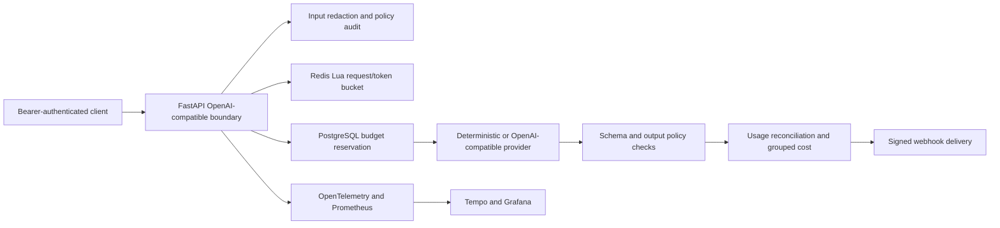

# Architecture dossier

The deterministic single-process profile substitutes in-memory state for PostgreSQL and Redis. It establishes contract behavior cheaply; the Compose profile establishes that the distributed adapters start and complete an authenticated request. Neither establishes failover or production capacity.
